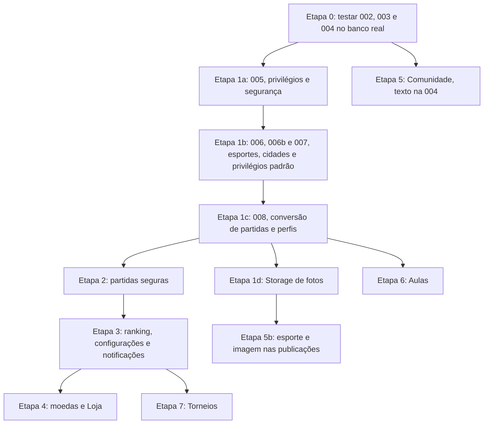

# Modelo de dados do Playnet

**Status:** plano aprovado em 03/11/2026 e revisado com as regras de concorrência, contestação, moedas e reputação. Só a 002, a 003 e a 004 foram implementadas; o resto é proposta. Este documento não contém SQL.

Só as tabelas de [002_partidas.sql](../supabase/migrations/002_partidas.sql) e [003_perfis_seguidores.sql](../supabase/migrations/003_perfis_seguidores.sql) têm migration, e você as executou no banco (informado em 03/11/2026). O teste da etapa 0 com duas contas reais ainda não tem resultado. A Comunidade, só de texto, está em [004_comunidade.sql](../supabase/migrations/004_comunidade.sql), também executada (informado em 03/11/2026). As decisões tomadas e o que ainda falta responder estão na [seção 5](#5-perguntas-e-decisões).

## Suposições

- O app continua falando direto com o Supabase, sem servidor próprio. As regras sensíveis ficam em RLS e em funções SQL.
- Você administra pelo painel do Supabase. Não há tela de administrador nem coluna `is_admin` nesta proposta. Aprovar professor e moderar são ações suas no painel. Corrigir resultado é feito por uma função interna, chamada no SQL Editor, nunca editando tabelas à mão (seção 3.4).
- O app é só para o Brasil.
- "Nota" e "rating" são a mesma coisa. Uso **rating**, o termo oficial em [rating.ts](../src/constants/rating.ts).
- A moeda se chama **Playnet Coins**, como já está no código. O banco usa o nome neutro `moedas`, então o nome de marca não entra no esquema.
- Os nomes seguem o padrão das migrations atuais: português, `snake_case` e `criado_em`.

## 1. Diagrama de entidades e relações

Legenda: **`auth_users`** representa `auth.users`, que pertence ao Supabase. Já têm migration `perfis`, `seguidores`, `partidas`, `partida_participantes`, `publicacoes`, `publicacao_curtidas` e `publicacao_comentarios`, com as colunas sem comentário. Todo o resto é proposto, e as colunas novas em tabelas existentes aparecem como `"proposta"`.

```mermaid
erDiagram
  auth_users ||--|| perfis : "tem"
  auth_users ||--o{ seguidores : "segue"
  auth_users ||--o{ seguidores : "e seguido"
  auth_users |o--o{ partidas : "cria"
  auth_users ||--o{ partida_participantes : "participa"
  partidas ||--o{ partida_participantes : "tem"

  esportes ||--o{ partidas : "classifica"
  cidades ||--o{ partidas : "sedia"
  cidades |o--o{ perfis : "localiza"
  perfis ||--o{ jogador_preferencias : "define"
  esportes ||--o{ jogador_preferencias : "de"
  perfis ||--o{ notificacoes : "recebe"

  partidas |o--o{ resultados : "tem"
  torneio_jogos |o--o{ resultados : "tem"
  resultados |o--o| resultados : "corrige"
  perfis |o--o{ resultados : "registra, confirma, contesta, resolve"
  esportes ||--o{ resultados : "de"
  resultados ||--|{ resultado_jogadores : "tem lados"
  perfis |o--o{ resultado_jogadores : "jogou"
  perfis ||--o{ ratings : "tem"
  esportes ||--o{ ratings : "de"
  perfis ||--o{ rating_historico : "evolui"
  esportes ||--o{ rating_historico : "de"
  resultados |o--o{ rating_historico : "gera"

  esportes |o--o{ loja_itens : "tema"
  loja_itens |o--o{ perfis : "em uso"
  perfis ||--o| moedas_saldos : "tem"
  perfis ||--o{ moedas_transacoes : "registra"
  perfis ||--o{ compras : "faz"
  loja_itens ||--o{ compras : "vendido em"
  moedas_transacoes |o--o| compras : "paga"
  resultados |o--o{ moedas_transacoes : "recompensa"

  perfis ||--o{ publicacoes : "publica"
  esportes |o--o{ publicacoes : "tema"
  publicacoes ||--o{ publicacao_curtidas : "recebe"
  perfis ||--o{ publicacao_curtidas : "curte"
  publicacoes ||--o{ publicacao_comentarios : "recebe"
  perfis ||--o{ publicacao_comentarios : "comenta"

  perfis ||--o| professores : "pode ser"
  professores ||--|{ professor_esportes : "ensina"
  esportes ||--o{ professor_esportes : "ensinado em"
  professores ||--o{ aula_horarios : "oferece"
  esportes ||--o{ aula_horarios : "de"
  cidades ||--o{ aula_horarios : "sedia"
  aula_horarios ||--o{ aula_reservas : "recebe"
  perfis |o--o{ aula_reservas : "reserva"
  aula_reservas ||--o| aula_avaliacoes : "gera"

  perfis |o--o{ torneios : "organiza"
  esportes ||--o{ torneios : "de"
  cidades ||--o{ torneios : "sedia"
  torneios ||--o{ torneio_inscricoes : "recebe"
  torneio_inscricoes ||--|{ torneio_inscricao_membros : "formada por"
  perfis |o--o{ torneio_inscricao_membros : "joga"
  torneios ||--o{ torneio_jogos : "chaveia"
  torneio_inscricoes |o--o{ torneio_jogos : "disputa"

  auth_users {
    uuid id PK
    text email
  }
  perfis {
    uuid id PK
    text nome_exibicao
    timestamptz criado_em
    int cidade_id FK "proposta"
    text foto_url "proposta"
    text titulo_atual_id FK "proposta"
    text banner_atual_id FK "proposta"
  }
  seguidores {
    uuid seguidor_id PK
    uuid seguido_id PK
    timestamptz criado_em
  }
  partidas {
    uuid id PK
    uuid criador_id FK "passa a aceitar nulo"
    text esporte "vira esporte_id"
    text local
    text cidade "vira cidade_id"
    text nivel "passa a ter check"
    timestamptz data_hora
    int vagas
    timestamptz criado_em
  }
  partida_participantes {
    uuid partida_id PK
    uuid user_id PK
    timestamptz criado_em
  }
  configuracoes {
    text chave PK
    int valor
    text descricao
    timestamptz atualizado_em
  }
  esportes {
    text id PK
    text nome
    int ordem
    boolean permite_simples
    boolean permite_duplas
  }
  cidades {
    int id PK "codigo IBGE"
    text nome
    text uf
    text nome_busca
  }
  jogador_preferencias {
    uuid user_id PK
    text esporte_id PK
    text dominante
    text lado
    text horario
  }
  notificacoes {
    uuid id PK
    uuid user_id FK
    text tipo
    text titulo
    text corpo
    timestamptz lida_em
    timestamptz criado_em
  }
  resultados {
    uuid id PK
    uuid partida_id FK
    uuid torneio_jogo_id FK
    text esporte_id FK
    text formato_id
    jsonb sets
    smallint lado_vencedor
    text status
    uuid registrado_por FK
    timestamptz registrado_em
    timestamptz confirmar_ate
    text confirmacao
    uuid confirmado_por FK
    timestamptz confirmado_em
    timestamptz contestar_ate
    uuid contestado_por FK
    timestamptz contestado_em
    text desfecho
    uuid desfecho_por FK
    timestamptz desfecho_em
    uuid corrige_resultado_id FK
  }
  resultado_jogadores {
    bigint id PK
    uuid resultado_id FK
    uuid user_id FK
    smallint lado
  }
  ratings {
    uuid user_id PK
    text esporte_id PK
    int rating
    int jogos_confirmados
    timestamptz atualizado_em
  }
  rating_historico {
    bigint id PK
    uuid user_id FK
    text esporte_id FK
    text origem
    uuid resultado_id FK
    int rating_antes
    int rating_depois
    timestamptz criado_em
  }
  loja_itens {
    text id PK
    text tipo
    text nome
    text descricao
    text emoji
    text esporte_id FK
    int preco
    boolean ativo
  }
  compras {
    uuid id PK
    uuid user_id FK
    text item_id FK
    int preco_pago
    bigint transacao_id FK "nula se preco zero"
    timestamptz criado_em
  }
  moedas_transacoes {
    bigint id PK
    uuid user_id FK
    int valor
    text tipo
    uuid resultado_id FK
    text chave_idempotencia UK
    text descricao
    timestamptz criado_em
  }
  moedas_saldos {
    uuid user_id PK
    int saldo
    timestamptz atualizado_em
  }
  publicacoes {
    uuid id PK
    uuid autor_id FK
    text texto
    text esporte_id FK "proposta"
    text imagem_path "proposta"
    timestamptz criado_em
  }
  publicacao_curtidas {
    uuid publicacao_id PK
    uuid user_id PK
    timestamptz criado_em
  }
  publicacao_comentarios {
    uuid id PK
    uuid publicacao_id FK
    uuid autor_id FK
    text texto
    timestamptz criado_em
  }
  professores {
    uuid id PK
    text bio
    boolean aprovado
    numeric media_estrelas
    int total_avaliacoes
    timestamptz criado_em
  }
  professor_esportes {
    uuid professor_id PK
    text esporte_id PK
  }
  aula_horarios {
    uuid id PK
    uuid professor_id FK
    text esporte_id FK
    int cidade_id FK
    text local
    timestamptz inicio
    timestamptz fim
    int vagas
    int vagas_restantes
    int preco_centavos
    timestamptz cancelado_em
  }
  aula_reservas {
    uuid id PK
    uuid horario_id FK
    uuid aluno_id FK
    text status
    timestamptz criado_em
    timestamptz cancelada_em
  }
  aula_avaliacoes {
    uuid reserva_id PK
    smallint estrelas
    text comentario
    timestamptz criado_em
  }
  torneios {
    uuid id PK
    uuid organizador_id FK
    text nome
    text esporte_id FK
    int cidade_id FK
    text local
    timestamptz data_hora
    text formato_id
    smallint jogadores_por_lado
    int max_inscricoes
    timestamptz criado_em
  }
  torneio_inscricoes {
    uuid id PK
    uuid torneio_id FK
    int cabeca_de_chave
    timestamptz criado_em
  }
  torneio_inscricao_membros {
    bigint id PK
    uuid inscricao_id FK
    uuid torneio_id FK
    uuid user_id FK
  }
  torneio_jogos {
    uuid id PK
    uuid torneio_id FK
    int fase
    int posicao
    uuid inscricao_1_id FK
    uuid inscricao_2_id FK
    uuid vencedor_inscricao_id FK
  }
```

## 2. Tabelas

### 2.1 Regras que valem para todas

Para não repetir em cada tabela:

- **RLS e acesso:** RLS ativado, policies explícitas, `revoke all` de `anon` e `authenticated` em toda tabela e view nova e, depois, `GRANT` só do necessário para `authenticated`, como na 004 e na 006. Nunca confiar nos privilégios padrão do Supabase, que dão acesso total a esses dois roles (veja "Privilégios padrão do projeto", na etapa 1).
- **Usuário nunca vem do cliente:** a identidade sempre sai de `auth.uid()`. Nenhuma função que o app alcança recebe o id do usuário como parâmetro.
- **"Só por função" significa:** o cliente não tem `INSERT`, `UPDATE` nem `DELETE` na tabela. Ele chama uma função SQL (RPC), que valida tudo e grava em uma única transação.
- **Funções:** `security definer`, com `search_path` vazio. O `EXECUTE` é retirado de `public`, `anon` e `authenticated`, e devolvido só a `authenticated` nas funções que o app chama. Revogar sem incluir `public` não basta, porque toda função nasce executável por ele. Funções internas, como a que credita moedas, não recebem esse `GRANT` e ficam em um esquema `privado`, fora do alcance da API.
- **Sequências:** toda sequência nova, inclusive a de um `id` sequencial, recebe `revoke all` de `anon` e `authenticated`. Em tabelas "só por função", ninguém recebe `USAGE`. Se o cliente gravar direto na tabela, uma coluna `serial` exige `grant usage` na sequência, e uma coluna `generated ... as identity` não exige.
- **Funções internas chamadas por você ou pelo `pg_cron`:** rodam sem usuário logado, então `auth.uid()` é nulo. Quando precisam registrar quem agiu, como em `privado.corrigir_resultado`, recebem esse id por parâmetro. Essa é a única exceção à regra acima, e o cliente não alcança esse esquema.
- **RLS não protege colunas:** a policy decide quais linhas alguém altera, não quais colunas. Colunas protegidas exigem `GRANT UPDATE` por coluna.
- **Tabelas novas apontam para `perfis`, não para `auth.users`:** o app não enxerga `auth.users`, então hoje precisa de duas consultas para mostrar nomes ([fetchProfileNames](../src/lib/perfis.ts)). Com a chave em `perfis`, uma consulta só traz os dois. A Comunidade é exceção, a seu pedido: aponta para `auth.users`, e o feed traz os nomes pela view `publicacoes_feed`.

### 2.2 O que já existe e precisa de ajuste

Encontrei seis pontos nas migrations atuais que atrapalham o que vem depois. A 002 e a 003 já foram executadas e não devem ser editadas: os ajustes vão em uma migration nova, a 005, dentro da etapa 1.

| Ponto | Problema | Proposta |
|---|---|---|
| `grant update on perfis` vale para a tabela inteira | Qualquer coluna nova, como o título em uso, nasce editável pelo próprio usuário | Na 005, trocar por `GRANT UPDATE` só em `nome_exibicao`, **antes** de adicionar colunas. `cidade_id` e `foto_url` recebem o grant na migration que as cria, porque não dá para conceder privilégio em coluna que ainda não existe |
| Os `grant` da 002 e da 003 não restringem nada, porque o projeto usa os privilégios padrão do Supabase, como o `pg_default_acl` confirmou | `authenticated` pode ficar com mais permissões do que as listadas, como `UPDATE` e `TRUNCATE`. O RLS continua bloqueando as linhas, e a API não oferece `TRUNCATE` | Revogar tudo de `authenticated` nessas tabelas e conceder só o necessário, como a 004 já faz |
| Entrar e sair de partida é `INSERT`/`DELETE` direto | Dá para entrar em partida lotada ou já jogada, e sair depois do resultado. A corrida da última vaga já está comentada na 002 | Na etapa 2, funções `entrar_na_partida` e `sair_da_partida`, com trava na linha da partida, e retirar a escrita direta. Até lá a 005 mantém esses privilégios, porque o app os usa |
| Criar partida são dois `INSERT` fora de transação | O criador pode ficar de fora se o segundo falhar, limitação já comentada na 002 | Na etapa 2, função `criar_partida` |
| O criador pode alterar a partida | Depois de um resultado, poderia trocar esporte ou data. O app não tem tela de edição, e a busca em `src/` não encontrou `UPDATE` em `partidas` | Na 005, retirar o `UPDATE` e a policy dele até existir essa tela |
| `partidas.criador_id` é `not null` e usa `on delete cascade` | Apagar a conta apagaria a partida e seu resultado, afetando o histórico de outras pessoas | Na 005, `drop not null` junto com `on delete set null`, porque um não funciona sem o outro (decisão 3.6) |

`esporte`, `cidade` e `nivel` também mudam de texto livre para valores controlados (decisões 3.1 a 3.3). O que a 005 mantém está detalhado na seção 4.

### 2.3 Base

#### `esportes`
- **Finalidade:** lista dos esportes aceitos, hoje em [sports.ts](../src/constants/sports.ts). É referenciada por quase todas as outras tabelas.
- **Colunas:** `id` (texto estável, como `tenis`), `nome`, `ordem`, `permite_simples`, `permite_duplas`.
- **Ler:** qualquer usuário logado.
- **Escrever:** ninguém pelo app. Só por migration.

#### `cidades`
- **Finalidade:** municípios do Brasil, para partidas, perfis, aulas, torneios e filtro do Ranking.
- **Colunas:** `id` (código IBGE), `nome`, `uf`, `nome_busca` (minúsculo e sem acento).
- **Ler:** qualquer usuário logado.
- **Escrever:** ninguém pelo app. Só por migration.

#### `configuracoes`
- **Finalidade:** valores que precisam mudar sem atualizar o app nem o agendamento. As funções leem daqui, nunca de um número fixo no código.
- **Colunas:** `chave`, `valor` (inteiro), `descricao`, `atualizado_em`.
- **Ler:** qualquer usuário logado, para o app poder mostrar prazos.
- **Escrever:** ninguém pelo app. Você altera pelo painel ou por migration.

| Chave | Valor inicial | Nasce na | Uso |
|---|---|---|---|
| `resultado_prazo_confirmacao_horas` | 72 | Etapa 3 | Prazo da confirmação automática. Considerar 24 quando houver push |
| `resultado_prazo_contestacao_tardia_horas` | 168 (provisório) | Etapa 3 | Prazo para contestar depois da confirmação automática |
| `moedas_por_resultado` | 10 (provisório) | Etapa 4 | Recompensa por resultado confirmado explicitamente |
| `moedas_recompensas_por_dia` | 3 (provisório) | Etapa 4 | Máximo de recompensas por dia |
| `moedas_recompensas_por_semana_mesma_dupla` | 1 (provisório) | Etapa 4 | Máximo por semana com o mesmo adversário |

### 2.4 Perfil

#### `perfis` (colunas novas)
- **Finalidade:** guardar o que hoje só dura enquanto o app está aberto em [user-context.tsx](../src/state/user-context.tsx).
- **Colunas:** `cidade_id` e `foto_url` na etapa 1. `titulo_atual_id` e `banner_atual_id` na etapa 4, porque dependem de `loja_itens`.
- **Ler:** qualquer usuário logado. Por isso, nenhum dado sensível entra nesta tabela.
- **Escrever:** o próprio usuário altera nome, cidade e foto. Título e banner só pela função `equipar_item`, que confere se o item foi comprado.

#### `jogador_preferencias` (acréscimo meu)
- **Finalidade:** mão ou pé dominante, lado e horário por esporte, mostrados no Perfil e hoje perdidos ao fechar o app.
- **Colunas:** `user_id` e `esporte_id` (chave), `dominante`, `lado`, `horario`.
- **Ler:** qualquer usuário logado.
- **Escrever:** só o próprio usuário, com `INSERT` e `UPDATE`. Sem `DELETE`, porque o app só salva preferências e nunca as apaga.
- **Privilégios:** `revoke all` de `anon` e `authenticated`, e `GRANT SELECT, INSERT, UPDATE` a `authenticated`. A chave é composta, então não há sequência.

### 2.5 Ranking

#### `resultados`
- **Finalidade:** o placar de um jogo, de partida ou de torneio. É a fonte de tudo no Ranking e nunca é apagado pelo app.
- **Colunas do jogo:** `partida_id` (com `on delete restrict`) ou `torneio_jogo_id` (exatamente um), `esporte_id`, `formato_id` (id de `MATCH_FORMATS`), `sets` (lista de placares, como no tipo `SetScore[]`), `lado_vencedor`.
- **Colunas de estado:** `status` (`pendente`, `confirmado`, `contestado`), `registrado_por`, `registrado_em`, `confirmar_ate`, `confirmacao` (`explicita`, `automatica`, `administrativa`), `confirmado_por`, `confirmado_em`, `contestar_ate`, `contestado_por`, `contestado_em`.
- **Colunas de disputa:** `desfecho` (`mantido`, `corrigido`, `anulado`), `desfecho_por`, `desfecho_em` e `corrige_resultado_id`, preenchidas só por `privado.corrigir_resultado`.
- **Unicidade:** índice único parcial em `partida_id` e outro em `torneio_jogo_id`, valendo só para `pendente` e `confirmado`. Assim, cada jogo tem no máximo um resultado ativo, mas um resultado contestado não impede registrar outro.
- **Nulos:** a tabela é nova, então `confirmado_por` já nasce anulável, com `on delete set null`, e não há `drop not null`. Ele fica nulo enquanto o resultado está pendente, na confirmação automática e se a conta for apagada. Por isso quem diz como houve a confirmação é `confirmacao`, não `confirmado_por`.
- **Ler:** qualquer usuário logado.
- **Escrever:** só por função.
  - `registrar_resultado` exige um participante, uma partida já passada e nenhum resultado ativo. Calcula o vencedor a partir dos sets e grava `confirmar_ate`.
  - `confirmar_resultado` exige alguém do outro lado.
  - `contestar_resultado` aceita todos os jogadores listados no resultado, de qualquer lado (seção 3.4).

#### `resultado_jogadores`
- **Finalidade:** quem jogou em cada lado. É uma cópia feita no registro, porque a lista de participantes da partida pode mudar depois e não tem lados.
- **Colunas:** `id`, `resultado_id`, `user_id` (fica nulo se a conta for apagada), `lado`. Há unicidade em `resultado_id` + `user_id`.
- **Ler:** qualquer usuário logado.
- **Escrever:** só por função, junto com `resultados`.

#### `ratings`
- **Finalidade:** rating atual de cada jogador em cada esporte, usado para montar o Ranking sem somar o histórico.
- **Colunas:** `user_id` e `esporte_id` (chave), `rating`, `jogos_confirmados`, `atualizado_em`.
- **Ler:** qualquer usuário logado.
- **Escrever:** só por função (`definir_nivelamento`, a confirmação de resultado, a contestação tardia e a correção administrativa).

#### `rating_historico`
- **Finalidade:** cada mudança de rating, para o gráfico de evolução do Perfil e para auditoria. As linhas nunca são editadas.
- **Colunas:** `id` (sequencial, com a sequência sob a regra da seção 2.1), `user_id`, `esporte_id`, `origem` (`nivelamento`, `resultado`, `correcao`, `reaplicacao`), `resultado_id`, `rating_antes`, `rating_depois`, `criado_em`.
- **Unicidade:** `resultado_id` + `user_id` + `origem`, para que nenhuma repetição aplique o mesmo efeito duas vezes. Como o nivelamento não tem `resultado_id` e nulos não colidem nessa regra, há outro índice único parcial: uma linha de `nivelamento` por usuário e esporte.
- **Ler:** qualquer usuário logado, porque o gráfico pode aparecer no perfil de outro jogador.
- **Escrever:** só por função.

#### `notificacoes` (acréscimo meu)
- **Finalidade:** avisar que há um resultado para confirmar. Sem isso, a confirmação pelo adversário não funciona bem. Também alimenta a tela de Notificações.
- **Colunas:** `user_id`, `tipo`, `titulo`, `corpo`, `lida_em`, `criado_em`.
- **Ler:** só o destinatário.
- **Escrever:** criar só por função. O destinatário só altera `lida_em`.

### 2.6 Loja e moedas

#### `loja_itens`
- **Finalidade:** catálogo de títulos e banners, hoje em [store.ts](../src/data/store.ts). O preço no banco passa a valer. A arte do banner continua no código, então banner novo ainda exige atualizar o app.
- **Colunas:** `id` (os mesmos ids de hoje, como `prodigio`), `tipo` (`titulo`, `banner`), `nome`, `descricao`, `emoji`, `esporte_id`, `preco` (zero ou mais), `ativo`.
- **Ler:** qualquer usuário logado.
- **Escrever:** ninguém pelo app. Você altera pelo painel ou por migration.

#### `compras`
- **Finalidade:** o que cada usuário comprou, substituindo `ownedTitles` e `ownedBanners`.
- **Colunas:** `user_id`, `item_id`, `preco_pago`, `transacao_id`, `criado_em`. Há unicidade em `user_id` + `item_id`.
- **Item de preço zero:** a compra é registrada sem transação, porque `valor` nunca é zero. Um check garante a coerência: `transacao_id` é nulo se, e somente se, `preco_pago` for zero.
- **Ler:** só o dono. O título e o banner em uso já aparecem em `perfis`, então os outros jogadores não precisam ver a lista.
- **Escrever:** só pela função `comprar_item`.

#### `moedas_transacoes`
- **Finalidade:** o registro oficial de toda entrada e saída de moedas. As linhas nunca são editadas nem apagadas. Um erro se corrige com uma nova linha.
- **Colunas:** `id` (sequencial, com a sequência sob a regra da seção 2.1), `user_id`, `valor` (nunca zero), `tipo` (`compra`, `recompensa`, `ajuste`, `estorno`), `resultado_id` (nas recompensas e nos descontos ligados a um resultado), `chave_idempotencia` (única), `descricao`, `criado_em`.
- **Coerência de sinal, por check:** `compra` é negativa; `recompensa` e `estorno` são positivos; `ajuste` pode ter qualquer sinal.
- **Índice:** `user_id` + `tipo` + `criado_em`, para o limite diário de recompensas.
- **Ler:** só o dono.
- **Escrever:** só por função. O cliente não tem nenhuma permissão de escrita.

#### `moedas_saldos`
- **Finalidade:** saldo atual, para leitura rápida e para impedir saldo negativo em compras simultâneas. A soma das transações precisa sempre bater com ele.
- **Colunas:** `user_id`, `saldo` (nunca negativo), `atualizado_em`.
- **Ler:** só o dono.
- **Escrever:** só por função, na mesma transação do registro em `moedas_transacoes`.

### 2.7 Comunidade

Já tem migration em `004_comunidade.sql`, só com texto. `esporte_id` e `imagem_path` ficam para quando houver a etapa 1 e o Storage. Os totais vêm da view `publicacoes_feed`, que também traz o nome do autor e se o usuário curtiu.

#### `publicacoes`
- **Finalidade:** as publicações do feed, conforme o tipo `Post` em [community.ts](../src/data/community.ts).
- **Colunas:** `autor_id`, `texto`, `esporte_id` (opcional), `imagem_path` (opcional, no Storage), `criado_em`.
- **Ler:** qualquer usuário logado.
- **Escrever:** o autor cria e apaga as suas. Não há edição, porque o app não tem essa função.

#### `publicacao_curtidas`
- **Finalidade:** quem curtiu o quê. Uma curtida por pessoa. O total vem de uma view com `security_invoker`, para que ela respeite o RLS.
- **Colunas:** `publicacao_id` e `user_id` (chave), `criado_em`.
- **Ler:** qualquer usuário logado.
- **Escrever:** o usuário cria e apaga só as próprias.

#### `publicacao_comentarios`
- **Finalidade:** comentários de uma publicação.
- **Colunas:** `publicacao_id`, `autor_id`, `texto`, `criado_em`.
- **Ler:** qualquer usuário logado.
- **Escrever:** o autor cria e apaga os seus. O dono da publicação não apaga comentários de outras pessoas.

### 2.8 Aulas

#### `professores`
- **Finalidade:** marca um usuário como professor. Nome e foto vêm de `perfis`, então não ficam duplicados.
- **Colunas:** `id` (o mesmo de `perfis`), `bio`, `aprovado`, `media_estrelas`, `total_avaliacoes`, `criado_em`.
- **Ler:** qualquer usuário logado vê os aprovados, e cada professor vê o próprio cadastro.
- **Escrever:** o usuário cria o próprio cadastro, ainda não aprovado, e altera só a `bio`. `aprovado` muda só pelo painel, e a média só por função.

#### `professor_esportes`
- **Finalidade:** o que cada professor ensina. O tipo `Teacher` atual aceita um só esporte, mas essa limitação seria cara de mudar depois.
- **Colunas:** `professor_id` e `esporte_id` (chave).
- **Ler:** qualquer usuário logado.
- **Escrever:** só o próprio professor.

#### `aula_horarios`
- **Finalidade:** horários concretos disponíveis. Repetição semanal, se existir, vira várias linhas criadas pelo app, sem regra de recorrência no banco.
- **Colunas:** `professor_id`, `esporte_id`, `cidade_id`, `local`, `inicio`, `fim`, `vagas`, `vagas_restantes`, `preco_centavos`, `cancelado_em`. Um mesmo professor não pode ter horários sobrepostos.
- **Ler:** qualquer usuário logado vê os de professores aprovados.
- **Escrever:** o professor aprovado cria e altera os seus, exceto `vagas_restantes`, que muda só por função. Horário com reserva é cancelado por função, não apagado.

#### `aula_reservas`
- **Finalidade:** a reserva de um aluno em um horário.
- **Colunas:** `horario_id`, `aluno_id`, `status` (`confirmada`, `cancelada`, `concluida`), `criado_em`, `cancelada_em`. Só pode haver uma reserva confirmada por aluno em cada horário.
- **Ler:** só o aluno e o professor daquele horário. Por isso `vagas_restantes` fica em `aula_horarios`: os outros alunos não conseguem contar as reservas.
- **Escrever:** só por função (`reservar_aula`, `cancelar_reserva`), com trava no horário para não passar das vagas.

#### `aula_avaliacoes` (acréscimo meu)
- **Finalidade:** alimentar as estrelas e o número de avaliações que o `TeacherCard` já mostra. Exigir uma reserva concluída impede avaliação de quem não teve aula.
- **Colunas:** `reserva_id` (chave), `estrelas` (1 a 5), `comentario`, `criado_em`.
- **Ler:** qualquer usuário logado.
- **Escrever:** só o aluno da reserva, por função, que também recalcula a média do professor.

### 2.9 Torneios

O código já usa torneios: [tournaments.ts](../src/data/tournaments.ts), [bracket.ts](../src/utils/bracket.ts) e a tela [torneio/[id].tsx](../src/app/torneio/[id].tsx). Hoje tudo fica em memória, e as inscrições usam nomes em vez de ids.

#### `torneios`
- **Finalidade:** os dados do torneio. O status continua calculado, como em `tournamentStatus`, em vez de virar uma coluna que pode ficar errada.
- **Colunas:** `organizador_id`, `nome`, `esporte_id`, `cidade_id`, `local`, `data_hora`, `formato_id`, `jogadores_por_lado`, `max_inscricoes`, `criado_em`.
- **Ler:** qualquer usuário logado.
- **Escrever:** o organizador cria em nome próprio e altera ou apaga enquanto não há chaveamento.

#### `torneio_inscricoes`
- **Finalidade:** cada inscrição é um jogador ou uma dupla.
- **Colunas:** `torneio_id`, `cabeca_de_chave` (definido ao gerar o chaveamento), `criado_em`.
- **Ler:** qualquer usuário logado.
- **Escrever:** só por função, que confere vagas e se o chaveamento já foi gerado.

#### `torneio_inscricao_membros`
- **Finalidade:** quem faz parte de cada inscrição. O `torneio_id` repetido aqui permite impedir que alguém entre duas vezes no mesmo torneio.
- **Colunas:** `id`, `inscricao_id`, `torneio_id`, `user_id`. Há unicidade em `torneio_id` + `user_id`.
- **Ler:** qualquer usuário logado.
- **Escrever:** só por função.

#### `torneio_jogos`
- **Finalidade:** cada jogo do mata-mata. Linhas, em vez de um único campo JSON, evitam que dois registros simultâneos sobrescrevam um ao outro. O placar fica em `resultados`.
- **Colunas:** `torneio_id`, `fase`, `posicao`, `inscricao_1_id`, `inscricao_2_id`, `vencedor_inscricao_id`. Há unicidade em `torneio_id` + `fase` + `posicao`.
- **Ler:** qualquer usuário logado.
- **Escrever:** só por função (`gerar_chaveamento` e o registro de resultado), e só pelo organizador.

### 2.10 Fora desta proposta

- **Stories:** adiados. Os tipos e componentes continuam no código (decisão P15).
- **Denúncias e bloqueios:** ainda não estão no diagrama, mas precisam existir antes de publicar nas lojas (decisão P14).
- **Locais com mapa:** o local continua como texto até o Google Maps entrar (decisão P19).
- **Produtos físicos na Loja:** a seção continua como "Em breve" (decisão P11).

## 3. Decisões difíceis de mudar depois

### 3.1 Esporte

**Decisão:** tabela `esportes` com um id de texto estável (`tenis`, `beach-tennis`, `futevolei`, `volei-de-praia`, `padel`, `tenis-de-mesa`) e chave estrangeira nas demais tabelas.

**Motivo:**
- O banco passa a recusar valores inválidos, o que o texto livre atual não faz.
- O id não muda se o nome exibido mudar, e versões antigas do app continuam funcionando.
- O id aparece direto nas linhas, então a maioria das consultas nem precisa de join.
- Os ids de banners em `STORE_BANNERS` já usam esse formato.

| Alternativa | Por que não |
|---|---|
| Texto livre (hoje) | Basta uma grafia diferente para separar um esporte em dois no Ranking |
| Tabela usando o nome `Tênis` como chave | Evita mudar o app agora, mas amarra os dados ao texto exibido. É o plano B, se preferir menos trabalho |
| Enum do Postgres | Remover ou renomear valores é trabalhoso, e não comporta dados como `permite_duplas` |
| Check repetido em cada tabela | A mesma lista em cerca de dez lugares |

**Custo:** formatos e preferências continuam em `Record<Sport, ...>` no código, então um esporte novo ainda exige atualizar o app. O app precisa traduzir entre id e nome em um único lugar, `sports.ts`. Não há dados a converter, porque as partidas de teste serão apagadas antes (P2).

### 3.2 Nível

**Decisão:** separar dois conceitos.
- **Nível da partida:** coluna de texto com check, aceitando `iniciante`, `intermediario` e `avancado`, os mesmos ids de `RATING_LEVELS`. É só uma indicação e não impede ninguém de entrar.
- **Nível do jogador:** não é guardado. O que existe é o rating, e o nível é calculado quando necessário.

**Motivo:** um nível salvo no jogador ficaria diferente do rating na primeira partida. Três valores que quase nunca mudam não justificam uma tabela, e um check é fácil de alterar. Como em 3.1, não há dados a converter (P2).

**Atenção:** `RATING_LEVELS` define só os ratings iniciais (500, 1000 e 1500), não as faixas. Se o app for mostrar o nível a partir do rating, essas faixas precisarão ser definidas.

### 3.3 Cidade

**Decisão:** tabela `cidades` preenchida com os 5.571 municípios que a API do IBGE devolveu em 04/11/2026, usando o código IBGE como chave. O campo `local` continua como texto livre.

**Motivo:** o Ranking filtra por estado e cidade. Com texto livre, "São Paulo", "sao paulo" e "SP" viram três cidades. O código IBGE é público e estável, e a lista não depende de serviço externo durante o uso. Quando o Google Maps entrar, uma futura tabela de locais pode apontar para `cidades` sem conflito.

| Alternativa | Por que não |
|---|---|
| Texto livre (hoje) | Os dados ficam sujos, e limpar depois é manual |
| Texto livre com normalização | Não resolve erros de digitação nem grafias diferentes |
| Só IDs do Google Places | Depende de uma API externa paga, que ainda não faz parte do projeto |

**Custo:**
- É preciso um seletor de cidade com busca nos formulários, um componente novo.
- `STATE_NAMES` lista só 6 estados e passaria a ter 27.
- Não há cidades a converter: as partidas de teste serão apagadas antes da conversão (P2).

### 3.4 Modelo do ranking

**Decisão:**
1. **Elo por esporte, igual ao código atual** ([use-rating-update.ts](../src/hooks/use-rating-update.ts)): K = 32, cada jogador contra a média de rating dos adversários, partindo do nivelamento (500, 1000 ou 1500).
2. **Calculado só no servidor.** O cliente não tem como gravar rating. Hoje o cálculo roda no aparelho, o que permitiria a qualquer pessoa escolher o próprio rating.
3. **Resultado só conta depois de confirmado pelo adversário** ou, sem resposta, quando vence o prazo configurável.
4. **Uma única tabela `resultados`** para partidas e torneios, para que o rating tenha uma só origem.
5. **Três camadas:** `resultados` (o fato), `rating_historico` (cada mudança) e `ratings` (o valor atual, para leitura rápida).

**Fluxo de uma partida:**

1. Depois do horário, um participante registra lados, formato e sets. O servidor calcula o vencedor e o status fica `pendente`.
2. O adversário recebe uma notificação e confirma. Qualquer jogador listado pode contestar. Sem resposta até `confirmar_ate`, o resultado é confirmado automaticamente.
3. Na confirmação, uma única transação atualiza `ratings`, grava `rating_historico` e marca o resultado como `confirmado`.
4. Resultado contestado não muda rating, e qualquer participante pode registrar um novo placar, em uma nova linha (decisão P5).

#### Concorrência na confirmação

`confirmar_resultado` e a confirmação automática seguem os mesmos passos, em uma única transação:

1. Travam a linha do resultado.
2. Só prosseguem se o status ainda for `pendente`. Assim, confirmar, contestar e o prazo vencer ao mesmo tempo produzem um único efeito.
3. Travam as linhas de `ratings` dos jogadores em ordem de `user_id`, o que evita que duas confirmações fiquem esperando uma pela outra. Quem não fez nivelamento não tem linha para travar.
4. Leem os ratings já travados, calculam o Elo e gravam `ratings` e `rating_historico`. A unicidade em `rating_historico` barra qualquer repetição.

**Ordem geral de travas, em toda função:** resultado, depois `ratings`, depois `moedas_saldos`, sempre em ordem de `user_id`.

A confirmação automática processa cada resultado em transação própria e pula linhas travadas, que ficam para a execução seguinte. Um resultado com problema não impede os outros.

#### Prazo da confirmação automática

- **Onde fica:** em `configuracoes`, começando em 72 horas. Não está no código nem no agendamento.
- **Como o valor chega ao `pg_cron`:** ele não chega. `registrar_resultado` lê a configuração e grava o prazo na própria linha, em `confirmar_ate`. A tarefa agendada roda a cada 15 minutos, chama uma função interna e só compara `confirmar_ate` com o horário atual.
- **Se o prazo for reduzido com resultados pendentes:** eles mantêm o prazo já gravado, que foi o prometido na notificação. O novo valor vale só para resultados novos. O mesmo acontece se o prazo aumentar.
- **Push:** considere 24 horas quando houver notificação push. Basta mudar o valor em `configuracoes`. Até lá, 72 horas é mais seguro, porque a pessoa só vê o aviso ao abrir o app.
- **Habilitar:** o `pg_cron` precisa ser ativado em Database > Extensions antes da migration da etapa 3.
- **Projeto pausado:** as confirmações ficam atrasadas até ele voltar. Nada se perde, porque a tarefa encontra os resultados vencidos na primeira execução depois disso, e `contestar_ate` conta a partir da confirmação real.

#### Contestação

Todos os jogadores listados no resultado podem contestar, não só o lado oposto. O que acontece depende do momento:

| Momento | Quem contesta | Efeito |
|---|---|---|
| Resultado `pendente` | Qualquer jogador listado, inclusive quem registrou, o que funciona como retirar o próprio registro | Status vira `contestado`, sem mudar rating |
| Confirmação automática, até `contestar_ate` | Qualquer jogador listado | Status vira `contestado`, e o rating é revertido por uma linha de `correcao` |
| Confirmação automática, depois de `contestar_ate` | Ninguém pelo app | Só correção administrativa |
| Confirmação explícita ou administrativa | Ninguém pelo app | Só correção administrativa |

**Contestação tardia:** tem prazo próprio, gravado em `contestar_ate` no momento da confirmação automática, a partir de `resultado_prazo_contestacao_tardia_horas`. Mudar a configuração não afeta prazos já gravados.

**Como o rating é revertido:** a função trava o resultado e os `ratings` na ordem acima. Para cada jogador com linha de `resultado`, subtrai do rating atual o que aquele jogo mudou e grava uma linha de `correcao`. `jogos_confirmados` diminui em 1. Os jogos seguintes não são recalculados. Como confirmação automática nunca paga moedas, não há moedas a devolver.

#### Correção administrativa

Você não edita tabelas à mão. A função interna `privado.corrigir_resultado`, chamada pelo SQL Editor, recebe o resultado, o desfecho, o seu id (porque `auth.uid()` é nulo ali) e, se for o caso, o placar certo. Ela preenche `desfecho`, `desfecho_por` e `desfecho_em` e registra os efeitos em `rating_historico`. O desfecho é final: a função recusa um resultado que já tenha desfecho, então não há ciclos.

| Desfecho | Efeito no resultado | Efeito no rating | Moedas |
|---|---|---|---|
| `mantido` | Volta ou continua como `confirmado`. Recusado se houver outro resultado ativo no mesmo jogo, que precisa ser resolvido antes | Se foi revertido, uma linha de `reaplicacao`. Se nunca foi aplicado, uma linha de `resultado`. Se continua aplicado, nada muda | Não paga nada novo, porque não houve confirmação explícita |
| `corrigido` | Fica como `contestado`, intacto. Uma nova linha, com `corrige_resultado_id` e `confirmacao = administrativa`, traz o placar certo | Reverte com `correcao`, se ainda estava aplicado. A nova linha aplica o placar certo | O que foi pago continua, porque o jogo existiu. A nova linha não paga |
| `anulado` | Fica como `contestado`, o que libera um novo registro | Reverte com `correcao`, se ainda estava aplicado | Desconta o que foi pago (P24) |

A origem `reaplicacao` existe por causa da unicidade em `rating_historico`: uma confirmação automática contestada já gerou uma `correcao`, então devolver o rating com "mantido" exigiria uma segunda linha igual.

**O que é caro de mudar e o que não é:** o algoritmo é a parte fácil. Com os resultados guardados e imutáveis, dá para trocar Elo por Glicko depois e recalcular tudo. O que não dá para recuperar são resultados não guardados ou ratings gravados pelo cliente, sem origem conhecida. Por isso, a regra importante é a das camadas, não a fórmula.

| Alternativa | Por que não |
|---|---|
| Elo no cliente (hoje) | Qualquer um grava o rating que quiser |
| Somar o histórico a cada leitura, sem `ratings` | Lento para montar o Ranking inteiro |
| Pontos por vitória | Premia quem joga mais, não quem joga melhor, e descarta o que o app já faz |
| Glicko-2 agora | Mais preciso para quem joga pouco, porém mais difícil de explicar e conferir. Pode vir depois |

**Regras herdadas do código atual:**
- Quem não fez nivelamento joga, mas seu rating não muda.
- Um adversário sem rating conta como 1000 (`ratingOf`).
- A ordem do histórico é a da confirmação, não a da data do jogo.

**Riscos e como ficam:**
- **Nivelamento:** como é uma autoavaliação, alguém pode escolher "Avançado". O mínimo de 5 jogos confirmados impede que apareça no Ranking sem jogar (decisão P7).
- **Combinação:** dois amigos ainda podem combinar resultados. O limite de 2 jogos por semana que mudam o rating reduz o ganho, mas não elimina o risco (decisão P8). A seção 3.7 trata do que vem depois.
- **Parceiro no 2x2 (risco conhecido):** depois de uma confirmação explícita, o parceiro de quem confirmou não pode contestar pelo app, só pela correção administrativa. Basta um dos dois confirmar para fechar o resultado dos dois, então o parceiro pode discordar e depender de você para corrigir.
- **Formato do jogo:** `vagas` aceita até 20 pessoas, mas só jogos 1x1 ou 2x2 contam para o rating (decisão P6).
- **Correção:** um resultado corrigido gera uma linha de `correcao`, mas não recalcula os jogos seguintes de ninguém. Isso é uma simplificação aceitável, e o recálculo completo continua possível.
- **Prazo vencido:** alguém pode registrar um resultado falso contra quem não responde, e o rating muda até uma contestação tardia. Por isso a confirmação automática nunca paga moedas (P10 e P23).

### 3.5 Modelo das Playnet Coins

**Decisão:**
1. **Registro imutável de transações.** `moedas_transacoes` é a verdade, e erros se corrigem com novas linhas.
2. **Saldo que o cliente não edita.** `moedas_saldos` é só leitura para o dono, nunca fica negativo e muda apenas junto com uma transação.
3. **Compra por função no servidor.** O app envia só o id do item.

**O que `comprar_item` faz, em uma única transação:**

1. Identifica o usuário por `auth.uid()`.
2. Lê o preço em `loja_itens`, nunca do cliente, e confere se o item está ativo.
3. Recusa se o usuário já possui o item, garantido também pela unicidade em `compras`.
4. **Se o preço for zero:** grava só a compra, sem transação e sem tocar no saldo, e devolve o saldo atual.
5. Desconta o saldo em uma única operação que só funciona se houver saldo suficiente. Duas compras simultâneas não conseguem gastar a mesma moeda.
6. Grava a transação e a compra, com o preço pago naquele momento.
7. Devolve o novo saldo.

**Recompensas:** só uma função interna credita moedas, usando `chave_idempotencia`, como `resultado:<id>:<usuario>`. Assim, repetir a execução não paga duas vezes.

Só paga o resultado confirmado explicitamente pelo outro lado (`confirmacao = explicita`, com `confirmado_por` não nulo naquele momento), nunca a confirmação automática nem a administrativa. Cada jogador listado recebe, com os próprios limites. Resultados confirmados antes da etapa 4 não pagam.

Dentro da transação de `confirmar_resultado`, depois dos `ratings`, para cada jogador em ordem de `user_id`:

1. Cria a linha de `moedas_saldos` com saldo 0, se não existir, sem sobrescrever. Sem isso, a trava seguinte não teria linha para travar justamente no caso de quem nunca recebeu moedas.
2. Trava essa linha, antes de qualquer checagem. Assim, duas confirmações simultâneas não passam juntas pelo limite.
3. **Limite diário:** conta as transações `recompensa` do jogador desde o início do dia em `America/Sao_Paulo`, calculado a partir de `moedas_transacoes`. Não há contador guardado.
4. **Limite semanal:** nos últimos 7 dias corridos, procura recompensas do jogador em resultados com algum adversário em comum com este, cruzando `moedas_transacoes.resultado_id` com `resultado_jogadores`. Assim, a virada da semana não zera o limite.
5. Se passou nos dois limites, grava a transação e soma ao saldo, com o valor de `moedas_por_resultado`.

Bater em um limite não é erro: o resultado é confirmado, só sem recompensa para aquele jogador. Os valores estão em `configuracoes` e são provisórios.

Essas regras reduzem o abuso, mas não o eliminam: duas contas combinadas conseguem confirmar uma à outra. O limite por dupla faz com que elas ganhem no máximo 10 moedas por conta por semana entre si.

**Anulação depois de pagar (P24):** a correção desconta o que foi pago com um `ajuste` negativo, até o saldo disponível, e perdoa o restante, porque o saldo não pode ficar negativo. Usa a `chave_idempotencia` `anulacao:<id>:<usuario>`.

| Alternativa | Por que não |
|---|---|
| Coluna de saldo em `perfis` | Com o `GRANT` atual, o próprio usuário poderia editá-la. Além disso, não explica de onde veio o saldo |
| Só o registro, somando a cada leitura | Fica mais difícil garantir saldo não negativo em compras simultâneas |
| Compra feita pelo cliente com vários `INSERT` | O cliente poderia enviar o preço que quisesse |
| Edge Function | Exige implantação à parte, enquanto uma função SQL já roda na mesma transação e combina com seu fluxo de executar SQL manualmente |

**Mudança no app:** [use-cosmetics-store.ts](../src/hooks/use-cosmetics-store.ts) passa a ser assíncrono, com estados de carregamento e erro. Hoje a compra só altera a memória do aparelho.

### 3.6 O que acontece ao apagar uma conta (acréscimo meu)

Essa decisão não estava no seu pedido, mas afeta as chaves estrangeiras de todas as tabelas. As lojas de aplicativos exigem exclusão de conta dentro do app, e a LGPD também dá esse direito ao usuário. O app ainda não tem essa função; aqui se decide só o que acontece com os dados.

**Decisão:** apagar os dados pessoais e anonimizar o histórico compartilhado.

| Tipo de dado | Ao apagar a conta | Tabelas |
|---|---|---|
| Só da pessoa | Apagado | `perfis`, `seguidores`, `partida_participantes`, preferências, `ratings`, `rating_historico`, moedas, compras, publicações, curtidas, comentários, notificações, cadastro de professor e seus horários |
| Compartilhado com outras pessoas | Mantido, com o usuário nulo, aparecendo como "Jogador removido" | `resultado_jogadores`, `torneio_inscricao_membros`, `aula_reservas`, `partidas.criador_id`, `torneios.organizador_id`, `resultados.registrado_por`, `resultados.confirmado_por`, `resultados.contestado_por`, `resultados.desfecho_por` |

**Motivo:** apagar um jogador em cascata removeria jogos do histórico dos adversários. Já bloquear a exclusão entraria em conflito com a exigência das lojas. Os deltas de rating dos adversários continuam válidos, pois não dependem de a conta existir.

**Efeito colateral:** uma partida futura sem criador continua aberta até a data, e um torneio sem organizador fica sem quem registre os resultados.

**Consequência técnica:** tabelas com usuário anulável não podem ter o usuário na chave primária. Por isso, `resultado_jogadores` e `torneio_inscricao_membros` têm `id` próprio. Essa é uma das razões para decidir isso antes de criar as tabelas.

**Nulos:** `on delete set null` só funciona em coluna que aceita nulo. `partidas.criador_id` existe hoje como `not null`, então a 005 faz `drop not null` junto com a troca da regra. `resultados.confirmado_por` é de tabela nova e já nasce anulável. Depois que a conta é apagada, `confirmacao` continua dizendo que a confirmação foi explícita, então o resultado não passa a parecer automático nem reabre a contestação tardia.

### 3.7 Reputação

Em duas fases. Só a fase (a) tem colunas. A fase (b) está apenas descrita, para que a fase (a) não precise mudar depois.

#### Fase (a): desfecho de disputa, junto com a etapa 3

`resultados` ganha `desfecho`, `desfecho_por` e `desfecho_em`, preenchidos só por `privado.corrigir_resultado`, além de `contestado_por` e `contestado_em`, gravados por `contestar_resultado`. Sem saber quem contestou, não haveria como atribuir um sinal depois.

| Desfecho | O que indica |
|---|---|
| `mantido` | O registro estava certo, e a contestação não procedeu |
| `corrigido` | O jogo existiu, mas o placar registrado estava errado |
| `anulado` | O resultado não deveria existir |

#### Fase (b): depois, sem colunas por enquanto

- **Avaliações de comportamento:** ligadas a resultados confirmados, só entre participantes do mesmo resultado, uma por par e por resultado.
- **Sinal de disputa:** calculado a partir de desfechos, nunca de contestações isoladas.
- **Consequências graduais:** primeiro confirmação explícita obrigatória, depois limite semanal, menor visibilidade e, por fim, suspensão manual, sempre decidida por você.
- **Exibição:** a nota só aparece depois de um mínimo de avaliações.
- **Decaimento:** o sinal perde peso com o tempo.
- **Denúncias e bloqueios:** uma denúncia abre análise e não muda a nota sozinha. Um bloqueio impede novas avaliações entre as duas contas.

#### Como cada regra reduz os riscos

| Regra | Retaliação | Contas combinadas |
|---|---|---|
| Só participantes de resultado confirmado | Quem nunca jogou com a pessoa não consegue atacá-la | Cada avaliação exige um jogo confirmado, sujeito aos limites |
| Uma por par e por resultado | Limita a vingança a uma nota por jogo | Duas contas não acumulam notas sem novos resultados |
| Sinal só de desfechos | Contestar por vingança não mancha ninguém até você decidir, e um "mantido" pesa contra quem contestou | Um grupo não cria sinal contra alguém só contestando em massa |
| Consequências graduais | Um erro ou ataque isolado não causa dano grande, e a suspensão nunca é automática | Primeiro reduzem a vantagem, como exigir confirmação explícita e limitar a frequência |
| Mínimo de avaliações | Uma nota ruim isolada nem aparece | Inflar a nota exige muitos jogos, não um só |
| Decaimento | Um ataque antigo perde efeito | Notas infladas no passado perdem valor sem atividade real |
| Denúncias e bloqueios | Quem foi bloqueado não continua avaliando, e denúncia não pune sozinha | Denúncias em grupo não geram punição automática |

**Riscos que continuam:**
- Um grupo pequeno de contas jogando só entre si ainda pode produzir resultados válidos e boas notas. As regras encarecem isso, mas não impedem. Sugestão para a fase (b): dar menos peso a avaliações repetidas das mesmas pessoas.
- A nota baixa dada logo depois de uma derrota continua possível. Sugestão: esconder a avaliação até os dois avaliarem ou o prazo acabar.
- O sinal de disputa depende das suas decisões. Com muitas disputas, a correção manual vira gargalo.

## 4. Ordem sugerida de implementação

| Etapa | O que inclui | Depende de | Arquivos do app que mudam junto |
|---|---|---|---|
| **0. Testar o que existe** | Testar a 002, a 003 e a 004 com duas contas reais. As migrations já foram executadas, e falta o resultado do teste | Nada | Nenhum |
| **1. Base** | Dividida em migrations menores, detalhadas abaixo | 0 | Veja a tabela da etapa 1 |
| **2. Partidas seguras** | `criar_partida`, `entrar_na_partida`, `sair_da_partida`, retirada de `INSERT` e `DELETE` diretos em `partida_participantes` e de `INSERT` em `partidas` | 1 | `src/lib/partidas.ts` |
| **3. Ranking** | Habilitar o `pg_cron` em Database > Extensions; `configuracoes` com os prazos; `resultados` com os desfechos, `resultado_jogadores`, `ratings`, `rating_historico`, `notificacoes`; nivelamento no servidor; confirmação automática; `privado.corrigir_resultado`; volta da tela de placar | 2, porque os lados saem de participantes confiáveis | `src/hooks/use-rating-update.ts`, `src/hooks/use-sport-profile.ts`, `src/hooks/use-ranking-filters.ts`, `src/data/ranking.ts`, `src/data/notifications.ts`, `src/app/(tabs)/ranking.tsx`, `src/app/(tabs)/perfil.tsx`, `src/app/notificacoes.tsx`, `src/app/partida/[id].tsx`, `src/components/matches/score-sheet.tsx`, `src/components/profile/rating-sheet.tsx`, `src/components/side-menu.tsx` e uma biblioteca nova de resultados em `src/lib/` |
| **4. Moedas e Loja** | Valores de moedas em `configuracoes`, `loja_itens`, `compras`, `moedas_transacoes`, `moedas_saldos`, `comprar_item`, `equipar_item`, recompensas, `titulo_atual_id` e `banner_atual_id` em `perfis` | 3, porque as recompensas vêm de resultados confirmados explicitamente (P10) | `src/hooks/use-cosmetics-store.ts`, `src/data/store.ts`, `src/state/user-context.tsx`, `src/app/(tabs)/index.tsx`, `src/app/jogador/[id].tsx`, `src/components/profile/edit-profile-sheet.tsx`, `src/components/side-menu.tsx` e uma biblioteca nova da loja em `src/lib/` |
| **5. Comunidade** | **Iniciada:** publicações de texto, curtidas e comentários estão na 004, já executada. Faltam denúncias e bloqueios, antes de ir para as lojas | Nada | Para denúncias e bloqueios: `src/components/community/post-card.tsx`, `src/app/post/[id].tsx`, `src/app/jogador/[id].tsx`, `src/lib/comunidade.ts` |
| **5b. Esporte e imagem** | `esporte_id` e `imagem_path` em `publicacoes` | 1 e Storage | `src/lib/comunidade.ts`, `src/data/community.ts`, `src/components/community/post-card.tsx`, `src/components/community/post-composer-sheet.tsx` |
| **6. Aulas** | `professores`, `professor_esportes`, `aula_horarios`, `aula_reservas`, `aula_avaliacoes` | 1 | `src/app/aprender.tsx`, `src/data/teachers.ts`, `src/data/venues.ts`, `src/hooks/use-teacher-search.ts`, `src/components/learn/teacher-card.tsx` |
| **7. Torneios** | `torneios`, inscrições, membros, jogos, geração do chaveamento, coluna `resultados.torneio_jogo_id`, que só pode nascer aqui | 3, porque os cabeças de chave usam rating e os jogos usam `resultados` | `src/state/tournaments-context.tsx`, `src/data/tournaments.ts`, `src/app/torneios.tsx`, `src/app/torneio/[id].tsx`, `src/components/tournaments/entry-sheet.tsx`, `src/components/tournaments/create-tournament-sheet.tsx` |

### Etapa 1 em detalhe

Novas migrations, sem editar a 002, a 003, a 004 nem a 005, que já foram executadas.

| Migration | Conteúdo | Arquivos do app que mudam junto |
|---|---|---|
| `005` privilégios e segurança | Revisão de grants da 002 e da 003, conforme a tabela abaixo; `UPDATE` em `perfis` só em `nome_exibicao`; retirada do `UPDATE` de `partidas`; `partidas.criador_id` com `drop not null` e `on delete set null` | Nenhum |
| `006` esportes e cidades | Tabelas `esportes` e `cidades`, com os 6 esportes | Nenhum |
| `006b` privilégios padrão | Retira `anon` e `authenticated` dos privilégios padrão de `postgres` em `public`, para tabelas, funções e sequências. O nome `006b` mantém a numeração da 007 e da 008 | Nenhum |
| `007` carga do IBGE | Os 5.571 municípios, em quatro arquivos: `007_cidades_carga_parte1.sql`, `007_cidades_carga_parte2.sql`, `007_cidades_carga_parte3.sql` e `007_cidades_verificacao.sql`, gerados por `scripts/gerar-cidades.mjs` | Nenhum |
| `008` conversão e perfis | Troca `esporte`, `cidade` e `nivel` de `partidas`; `cidade_id` e `foto_url` em `perfis`, com o `GRANT UPDATE` delas; `jogador_preferencias`, com `revoke all` de `anon` e `authenticated` e `GRANT SELECT, INSERT, UPDATE` a `authenticated` | `src/lib/partidas.ts`, `src/data/matches.ts`, `src/constants/sports.ts`, `src/components/matches/schedule-match-sheet.tsx`, `src/components/matches/match-card.tsx`, `src/app/partida/[id].tsx`, `src/state/user-context.tsx`, `src/components/profile/edit-profile-sheet.tsx`, `src/hooks/use-sport-profile.ts` e um seletor de cidade novo |
| Próxima livre: Storage | Bucket e policies de foto. Fica à parte porque pode ser adiado | `src/services/profile-photo.ts`, `src/hooks/use-profile-photo-picker.ts`, `src/app/(tabs)/perfil.tsx` |

#### O que a 005 precisa manter

Busca em todo o `src/` por `.update(`, `.delete(`, `.insert(`, `.upsert(` e `.rpc(`: não há `.rpc(` nem `.upsert(`, e nenhuma escrita em `partidas` usa `UPDATE`. A 005 não pode quebrar o que o app usa hoje:

| Tabela | O app usa | Onde | Privilégios de `authenticated` depois da 005 |
|---|---|---|---|
| `perfis` | `UPDATE` do nome | `src/lib/perfis.ts` (`updateDisplayName`) | `SELECT` e `UPDATE (nome_exibicao)` |
| `seguidores` | `INSERT`, `DELETE` | `src/lib/perfis.ts` (`followUser`, `unfollowUser`) | `SELECT`, `INSERT`, `DELETE` |
| `partidas` | `INSERT`, `DELETE` (limpeza quando o criador não consegue entrar) | `src/lib/partidas.ts` (`createMatch`) | `SELECT`, `INSERT`, `DELETE` |
| `partida_participantes` | `INSERT`, `DELETE` | `src/lib/partidas.ts` (`createMatch`, `joinMatch`, `leaveMatch`) | `SELECT`, `INSERT`, `DELETE` |

`INSERT` e `DELETE` de partidas e participantes continuam até a etapa 2, quando as funções os substituem e o app muda junto. O trigger que cria o perfil roda como `security definer`, então não depende de `INSERT` de `authenticated`. `anon` continua sem nenhum privilégio.

**Teste rápido depois da 005, com duas contas:**

1. Criar uma partida e vê-la na lista.
2. Com a outra conta, entrar e sair da partida.
3. Seguir e deixar de seguir.
4. Trocar o nome em "Editar perfil".
5. Publicar e curtir, para confirmar que a 004 não foi afetada.
6. No painel, conferir os privilégios das quatro tabelas contra a tabela acima.

#### Privilégios padrão do projeto (006b)

**Resultado registrado em 04/11/2026.** A consulta em `pg_default_acl`, feita **depois** de executar a 005, mostra que `anon` e `authenticated` continuam com acesso total por padrão em tabelas, `EXECUTE` em funções e `rwU` em sequências, com donos `postgres` e `supabase_admin`.

**Ainda não explicado:** a 005 deveria ter retirado as entradas de tabelas e funções de `postgres`. O resultado acima não separa as entradas por dono, então há dois casos possíveis:
- **Tabelas e funções só em `supabase_admin`, e `postgres` só com sequências:** é o que a 005 deveria deixar.
- **`postgres` ainda com tabelas ou funções:** o item 5 da 005 não teve efeito, e a causa precisa ser investigada, porque a 006b usa o mesmo tipo de comando.

A consulta de verificação da 006b separa por dono, tipo e beneficiado, e mostra qual é o caso. A 005 não é editada, porque já foi executada: o ajuste vai na 006b.

**O que fica de fora da 006b:**
- Os padrões de `supabase_admin`, que o `postgres` não deve conseguir alterar. Tudo o que `supabase_admin` criar em `public` continua nascendo aberto.
- O `EXECUTE` de `public` em funções novas, porque esse padrão é global.

Por isso, a regra da seção 2.1 vale mesmo depois da 006b: cada objeto novo faz o próprio `revoke`.

#### Carga do IBGE (007)

- **Fonte:** a API de localidades do IBGE, a fonte oficial, baixada em 04/11/2026. Nunca uma lista escrita de memória.
- **Total:** 5.571 municípios nas 27 UFs. Os 6 municípios de controle bateram com a API.
- **Arquivos:** `007_cidades_carga_parte1.sql`, `007_cidades_carga_parte2.sql` e `007_cidades_carga_parte3.sql`, com 1.857 municípios cada, e `007_cidades_verificacao.sql`, só de leitura. Executar nessa ordem, depois da 006.
- **Geração:** `scripts/gerar-cidades.mjs`, que valida os dados e não grava nenhum SQL se algo falhar. A resposta bruta da API fica fora do repositório.
- **Formato:** `INSERT` em lotes de cerca de 500 linhas, entre `begin` e `commit`, e pode ser executado de novo sem duplicar.
- **Verificação depois de executar:** `007_cidades_verificacao.sql`, com 46 linhas esperadas: total de 5.571, 27 UFs, contagem por UF, nenhum `nome_busca` divergente, os 6 municípios de controle (3550308 São Paulo, 3509502 Campinas, 3304557 Rio de Janeiro, 5300108 Brasília, 3548906 São Carlos e 3543402 Ribeirão Preto), o teste de prefixo e o índice. O `EXPLAIN` fica em comentário, para rodar à parte.

#### Conversão de partidas (008)

Não há dados a converter: as partidas de teste serão apagadas antes, e os participantes saem junto, em cascata. A 008 exige `partidas` vazia e para com erro se não estiver, em vez de apagar algo por conta própria. O app muda junto, porque as colunas antigas deixam de existir.

**Observações:**
- A ordem fixa é 0 → 1 → 2 → 3, e as etapas 4 e 7 vêm depois da 3. A etapa 6 pode acontecer a qualquer momento depois da 008, e a 5 já começou na versão só de texto.
- Vale fazer a etapa 1 antes de haver usuários reais: hoje as partidas de teste podem ser apagadas, e depois cada texto livre precisaria ser convertido.
- Se quiser algo visível rapidamente, a Comunidade é o caminho mais curto: as telas e os componentes já existem, e as regras são simples. Se o foco for o que diferencia o app, vá direto para o Ranking.

## 5. Perguntas e decisões

Respondidas em 03/11/2026: a moeda se chama Playnet Coins, e as demais recomendações foram aceitas. Nada aqui bloqueia a etapa 1. **Provisórios:** os valores de moedas (P10) e o prazo de contestação tardia (P5), todos em `configuracoes`. **Em aberto até a fase (b):** os números de reputação (P25).

### Antes da etapa 1

| # | Pergunta | Decisão |
|---|---|---|
| **P1** | O nome da moeda é **Rally Coins** ou **Playnet Coins**? O código e as telas usam Playnet Coins. | **Playnet Coins.** O banco fica neutro, e o nome já é o usado no app. |
| **P2** | Você já executou a 002 e a 003? Há partidas reais no banco que precisem ser preservadas? | **Executadas, e `partidas` estava vazia** (informado em 03/11/2026). As partidas de teste serão apagadas antes da conversão de esporte e cidade, então não há dados a converter. |
| **P3** | Ao apagar uma conta, o histórico compartilhado fica anônimo, como em 3.6? | Sim. |
| **P4** | As tabelas `esportes` e `cidades` podem ser adotadas agora, com o seletor de cidade novo e só o Brasil? | Sim, com ids estáveis e lista do IBGE. |

### Ranking

| # | Pergunta | Decisão |
|---|---|---|
| **P5** | O que acontece se o adversário não responder ou contestar? | Sem resposta, confirma automaticamente no prazo de `configuracoes`, que começa em 72 horas, com uma tarefa agendada no banco (`pg_cron`). Considerar 24 horas quando houver push. Todos os jogadores listados podem contestar. Depois de confirmação automática, há um prazo próprio para contestar, provisoriamente de 7 dias, e o rating é revertido. Contestado não conta, e qualquer participante pode registrar um novo placar. Em impasse, você decide com `privado.corrigir_resultado`, pelo SQL Editor. |
| **P6** | Quais partidas contam para o ranking? | Só 1x1 ou 2x2, respeitando `SPORT_MODALITIES`. Os lados são definidos ao registrar o resultado. Partidas maiores não contam. |
| **P7** | Quantos jogos alguém precisa ter para aparecer no Ranking? E pode refazer o nivelamento? | 5 jogos confirmados. O nivelamento é feito uma vez por esporte. |
| **P8** | Limitar jogos repetidos entre as mesmas pessoas? | Sim, no máximo 2 em 7 dias corridos mudam o rating, contando qualquer adversário em comum. Os demais ficam só no histórico. |
| **P9** | Simples e duplas do mesmo esporte têm o mesmo rating? | Sim, como no código atual. Separar depois é possível, porque os resultados guardam os lados. |

### Moedas e Loja

| # | Pergunta | Decisão |
|---|---|---|
| **P10** | Como o usuário ganha moedas? Nada no código define isso. | Só por resultado confirmado explicitamente pelo outro lado, nunca pela confirmação automática. Sem venda por dinheiro real na primeira versão. **Valores provisórios, em `configuracoes`:** 10 moedas por resultado, no máximo 3 recompensas por dia e 1 por semana com a mesma dupla de jogadores. |
| **P11** | A seção "Produtos reais" vai existir de verdade? Isso envolve estoque, endereço, frete e possivelmente questões fiscais. | Manter "Em breve" e modelar só quando decidir. |
| **P12** | Há intenção de vender moedas por dinheiro? Moeda virtual vendida em app costuma exigir a compra integrada das lojas, com comissão, além de guardar registros mesmo após a exclusão da conta. | Não por enquanto. Isso mudaria a regra 3.6 para as transações. |
| **P23** | Quais resultados pagam moedas? Com a confirmação automática (P5), alguém pode registrar um resultado falso contra um adversário que não responde e receber moedas. | **Só os confirmados explicitamente** (`confirmado_por` não nulo no momento da confirmação), com limite diário e por dupla, porque duas contas combinadas conseguem confirmar explicitamente. Depois de confirmado, quem identifica o caso é `confirmacao`, porque `confirmado_por` fica nulo se a conta for apagada. |
| **P24** | E se um resultado que pagou moedas for anulado? | Descontar com `ajuste` negativo até o saldo disponível e perdoar o restante, porque o saldo não pode ficar negativo. Só acontece por correção sua, já que a confirmação automática não paga. |

### Reputação

| # | Pergunta | Decisão |
|---|---|---|
| **P25** | Como tratar a reputação dos jogadores? | Em duas fases (seção 3.7). **Agora:** desfecho de disputa em `resultados`, preenchido só pela função interna. **Depois, só descrita:** avaliações de comportamento, sinal calculado de desfechos e consequências graduais. **Em aberto até lá:** mínimo de avaliações, ritmo de decaimento e os limites de cada consequência. |

### Comunidade

| # | Pergunta | Decisão |
|---|---|---|
| **P13** | O feed mostra todo mundo ou só quem a pessoa segue? | Os dois: "Para você" mostra todo mundo, e "Seguindo" mostra quem a pessoa segue e as próprias publicações. |
| **P14** | Criar denúncia e bloqueio antes de publicar nas lojas? As regras da Apple e do Google exigem esses recursos em apps com conteúdo de usuários. | Sim, antes de ir para as lojas. Não precisa ser antes de testes internos. |
| **P15** | Stories entram no plano? Seriam uma tabela a mais, com expiração e Storage. | Adiar. Os componentes continuam no projeto. |
| **P16** | Publicações têm foto já na primeira versão? | Não: a primeira versão é só de texto. Foto entra depois da etapa 1 e do Storage. |

### Aulas

| # | Pergunta | Decisão |
|---|---|---|
| **P17** | Qualquer usuário pode virar professor ou precisa de aprovação? | Aprovação sua pelo painel. |
| **P18** | O pagamento da aula passa pelo app? Pagamento real envolve gateway, repasse, reembolso e tabelas adicionais. E qual é a regra de cancelamento? | Pagamento fora do app, com preço só informativo. O aluno cancela até 24 horas antes, e o professor a qualquer momento. |
| **P19** | Criar uma tabela de locais (clubes, quadras) agora ou manter texto até o Google Maps? O tipo `Venue` já existe no código. | Manter texto. Sem a tabela, a busca e o cartão de professor perdem a distância e o local fixo por enquanto. |

### Torneios

| # | Pergunta | Decisão |
|---|---|---|
| **P20** | Qualquer usuário pode criar torneio? | Sim, como no código atual. |
| **P21** | O parceiro de dupla precisa aceitar a inscrição? | Não na primeira versão. Qualquer membro pode retirar a dupla, como faz `removeEntry` hoje. |
| **P22** | Quem registra os resultados, e eles contam para o rating? | O organizador registra e conta, como hoje. Se o organizador jogar aquele jogo, o adversário confirma, para que ninguém declare a própria vitória. |
